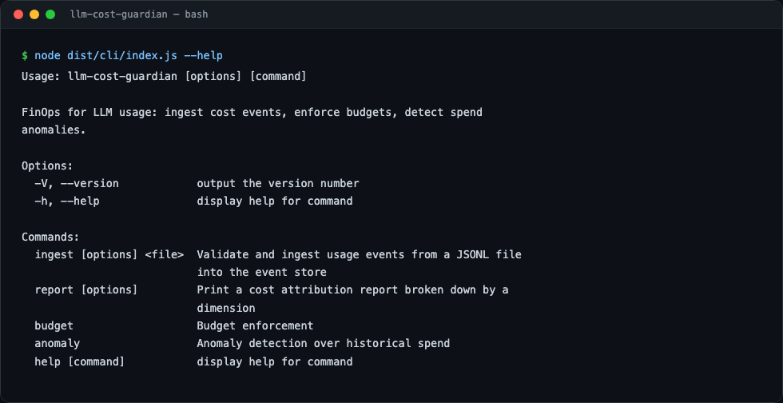
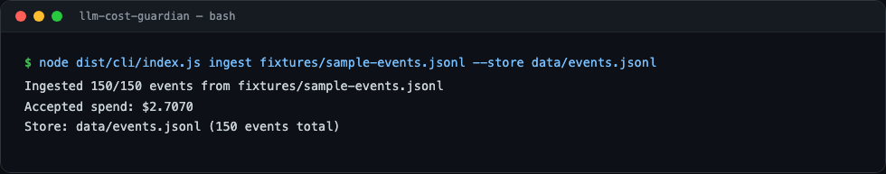
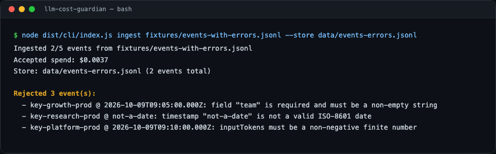
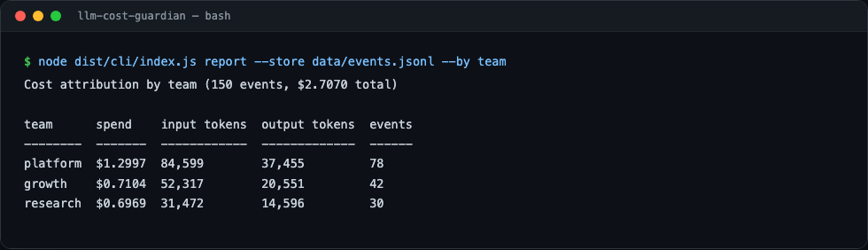
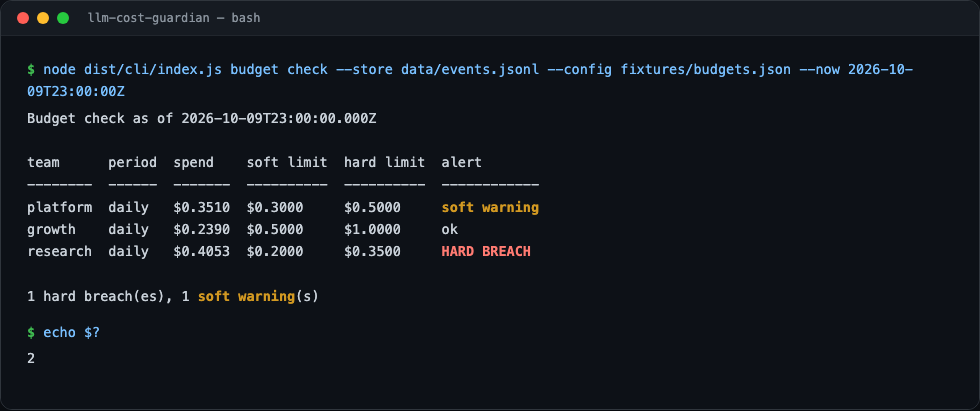
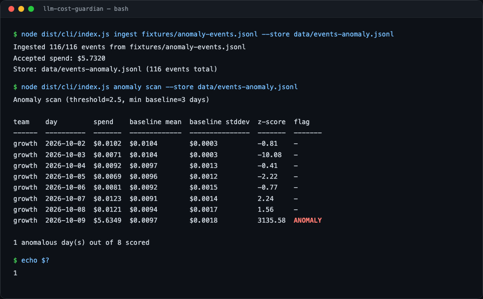

# llm-cost-guardian

A FinOps tool for LLM usage: ingest per-request token/cost events from multiple API keys and
teams, enforce configurable budgets with hard/soft alerts, detect anomalous spend spikes, and
attribute cost by team, API key, model, and provider.

## Project Status

This project is built in public, one night at a time. See **[PROGRESS.md](PROGRESS.md)** for
the architecture, the phased build plan, and exactly where work resumes next.

**Current phase:** Phase 1 (core foundation) is complete — validated ingestion, pluggable
storage, cost attribution, budget enforcement, anomaly detection, and a CLI, all with tests.
Phase 2 (HTTP ingestion API + durable storage) is next.

## Preview

All commands below are real `llm-cost-guardian` CLI invocations against the sample fixtures in
this repo — captured output, not mockups.

**`--help`**


**Ingesting a batch of usage events**


**Ingesting a batch with bad rows — validation errors are reported per-row, good rows still land**


**Cost attribution report, grouped by team**


**Budget check — soft warning, hard breach, and ok, side by side (and a non-zero exit code for scripting)**


**Anomaly scan — a real spend spike flagged against a team's own daily baseline**


## Features (Phase 1)

- **Validated ingestion** — every event is checked for required fields, a parseable timestamp,
  and non-negative token counts before it's accepted; bad rows are rejected individually with a
  specific reason, not as a batch failure.
- **Automatic cost calculation** — if an event doesn't carry a `costUsd`, it's computed from a
  per-model USD/1K-token pricing table.
- **Pluggable storage** — all logic is written against an `EventStore` interface. Phase 1 ships
  an in-memory store (for tests) and a JSON-file store (for the CLI); Phase 2 swaps in a SQL
  backend without touching attribution/budget/anomaly code.
- **Cost attribution** — aggregate spend, tokens, and event counts by team, API key, model, or
  provider.
- **Budget enforcement** — configure daily or monthly soft/hard limits per team; `budget check`
  reports current-period spend and alert level, and exits non-zero on a breach so it's safe to
  wire into cron or CI.
- **Anomaly detection** — flags days where a team's spend is a statistical outlier (z-score)
  against that team's own prior-day history, with a configurable threshold and baseline window.

## Quickstart

```bash
npm install
npm run build

# Generate the deterministic sample datasets used throughout this README
node scripts/generate-fixtures.mjs

# Ingest usage events into a local JSON-file-backed store
node dist/cli/index.js ingest fixtures/sample-events.jsonl --store data/events.jsonl

# See cost attribution by team / apiKeyId / model / provider
node dist/cli/index.js report --store data/events.jsonl --by team

# Check budgets (exits 2 on a hard breach, 1 on a soft warning, 0 otherwise)
node dist/cli/index.js budget check --store data/events.jsonl --config fixtures/budgets.json

# Scan for anomalous daily spend
node dist/cli/index.js anomaly scan --store data/events.jsonl
```

During local development you can skip the build step and run the CLI directly via `npm run cli -- <args>`.

## Testing

```bash
npm test         # run the full suite once
npm run test:watch
npm run typecheck
```

35 unit tests cover ingestion validation, pricing, storage (in-memory + JSON-file persistence),
cost attribution, budget evaluation (daily/monthly, soft/hard, team-scoping), and anomaly
detection.

## Architecture

See [PROGRESS.md](PROGRESS.md) for the full architecture diagram and phased roadmap.
